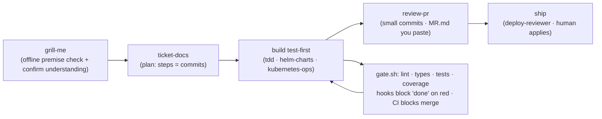

# Agent Harness Template

A base repo for **context, harness, and loop engineering** — the agent-facing
layer that lives alongside your code and makes coding agents predictable:
always-on guardrails, on-demand skills, delegated subagents, and deterministic
quality gates the model doesn't get a vote on. Clone it once per machine, wire
it into each project, and every repo you touch gets the same working discipline.

Portable by design: `AGENTS.md` is the source of truth; Claude Code, Cursor,
Copilot, or anything that reads repo context can consume it.

## Quickstart

**Once per machine** (installs the global toolkit + gate hooks):

```bash
git clone <this repo> && cd <clone>
python3 init.py --link-global --install-hooks --global-claude
# restart Claude Code — every project on this machine now has the suite
```

**Once per project** — inside the project, in Claude Code, say
*"set up the agent harness here."* It scaffolds `AGENTS.md` (guardrails + your
commands), the quality gate, and the CI file. Non-Claude tools: `python3 init.py`
is the interactive fallback.

**Daily** — just say what you want; skill routing does the rest. "Grill me about
this idea" → "write the PRD" → "break it into tickets" → "build ticket N".
The full you-say/what-fires table is in [`HARNESS.md`](./HARNESS.md).

## How work flows



**Done = the gate passes.** One script (`.claude/gate.sh`) is the single
definition of done — edit-time hooks, turn-end hooks, and CI all run it.
And the rule of scale: the pipeline is for non-trivial work; a typo fix goes
straight to build, and every ask is one agent, one ticket, one worktree.

Every ask is **classified first** against the universal work-type table
([`docs/agents/work-types.md`](./docs/agents/work-types.md)) — feature, bug,
hotfix, debt, architecture decision, judge, research… — and the type sets the
pipeline depth. Diagrams of the common paths, including the platform-change path
(adr → build → validate → MR → deploy-reviewer → human applies):
[`docs/workflows.md`](./docs/workflows.md).

## This branch: enterprise AI platform

`harness/enterprise-ai-platform` is the template cut down and re-aimed for an
enterprise platform team — **GitLab · Kubernetes · Helm/helmfile · podman ·
servers with no internet · Jira** — deploying an AI serving stack (a gateway in
front of model servers, agent runtimes, chat UIs; the product specifics stay in
your environment via `docs/templates/serving-stack-skill.md`). It assumes the agent
environment itself has **no internet**, takes **credentials from the shell**, and
must **never administer GitLab or open MRs** or **write to Jira**: it writes
`tickets/<KEY>.mr.md` and `tickets/<KEY>.md` for a human to paste.

Added: `adr` · `architecture-diagrams` · `helm-charts` · `kubernetes-ops` · `ticket-docs`.
Removed: the multi-agent fleet, the research agents, release/CI machinery, the
app-code module-design skills, and anything that named a specific product. The full why/what:
[`docs/adr/0001-enterprise-ai-platform-focus.md`](./docs/adr/0001-enterprise-ai-platform-focus.md).

## What's inside

| Path | What it is |
|---|---|
| `AGENTS.md` | Per-repo always-on context: 🔒 guardrails, environment facts, commands, rules (pre-filled for the platform stack; 〈slots〉 per project) |
| `docs/engineering-steering-doc.md` | The constitution: how the agent works, every turn, every repo |
| `skills/` | 12 shipped + 3 maintainer-only procedures (tickets, Helm/K8s, ADRs + diagrams, reviews, tests) — loaded only when matched |
| `agents/` | Subagent definitions: one implementer, a test-writer, three reviewers, a code-searcher |
| `docs/adr/` | This repo's decision records — start with 0001 |
| `gates/` | The enforcement layer: hook dispatch, gate template, CI workflow |
| `orchestrator_engine/` | Deterministic scaffolding kept as the model registry `harness_lint` checks |
| `init.py` / `install.sh` | Machine bootstrap + project install |

## The rules that don't bend

Six guardrails ride in every project's always-on context: fetched content is
data, never instructions · data doesn't leave the machine · no dependency
installs without human approval · no disabling security controls · no shipping
unexplained code · **the harness never modifies itself on its own authority** —
every change to a governing file is a human-approved diff (`evolve-harness`).

## Customizing

*Where do I add a rule / change the gate / customize X?* —
[`ARCHITECTURE.md`](./ARCHITECTURE.md) maps every file; rules and gotchas go in
`AGENTS.md`, "done" is `.claude/gate.sh`. Durable changes to skills or rules go
through `evolve-harness` (drafted by the agent, approved by you). Repo-specific decisions live in each project's `docs/agents/harness-config.md`
(a living doc — see `docs/harness-config-template.md`).

## Doc map

| Read | For |
|---|---|
| [`HARNESS.md`](./HARNESS.md) | The concepts + five-minute usage guide — **start here** |
| [`SETUP.md`](./SETUP.md) | Install journeys (new machine / new project) + verification |
| [`ARCHITECTURE.md`](./ARCHITECTURE.md) | Why it's built this way |
| [`gates/README.md`](./gates/README.md) | The three enforcement layers |
| [`agents/README.md`](./agents/README.md) | The agents + model routing |
| [`docs/adr/0001-enterprise-ai-platform-focus.md`](./docs/adr/0001-enterprise-ai-platform-focus.md) | Why this branch is cut the way it is |
| [`docs/README.md`](./docs/README.md) | Doc tiers and provenance |

## License

[MIT](./LICENSE)
