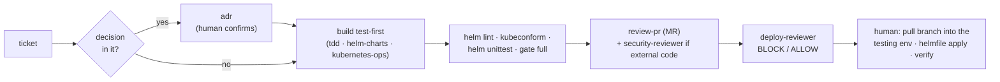
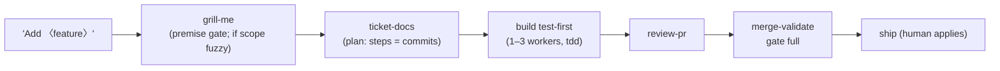
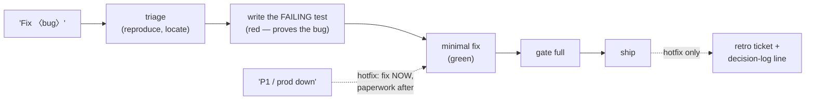
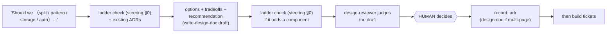
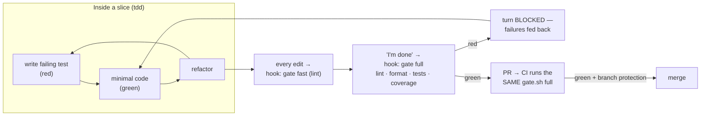

# Workflows — the common paths, drawn

> Diagrams of what actually happens for each kind of ask. The **taxonomy** lives
> in [`docs/agents/work-types.md`](./agents/work-types.md) and the **procedures**
> in the skills each box names — this file only draws them. If a diagram and
> those files disagree, the files win.

## Ship a platform change (chart · manifest · pipeline) — the common path here

## Add a feature (Type A)

Small, well-understood feature? Skip straight from the ask to build — the
pipeline is for non-trivial work (the escape valve).

## Fix a bug (Type B) — and the hotfix variant

One worker, always. The failing test comes *before* the fix — a bug fix without
a red test is a guess that compiles.

## Architecture decision — prepare, then escalate

The agent never decides expensive-to-reverse questions. The references outrank
model priors — that's what makes N agents give one answer.

## Testing & the gate (how "done" is proven, every path)

One script (`.claude/gate.sh`) is the definition of done at all three layers —
edit hook, stop hook, CI. Coverage is a floor set at honest reality and raised
by tickets, never gamed.

Changelog:
- 2026-10-16 — 1.2.0: second cut — ci-cd / prd-to-issues / architecture-patterns
  boxes replaced by ticket-docs, the ladder, and the human's testing-env apply.
- 2026-10-16 — 1.1.0: enterprise-ai-platform branch — orchestrator spine removed
  with the agent; added the platform-change path (adr → build → validate → MR →
  deploy-reviewer → ci-cd); architecture path records via `adr`.
- 2026-08-18 — 1.0.0: initial — spine + the four most-asked paths (feature,
  bug/hotfix, architecture, testing).
