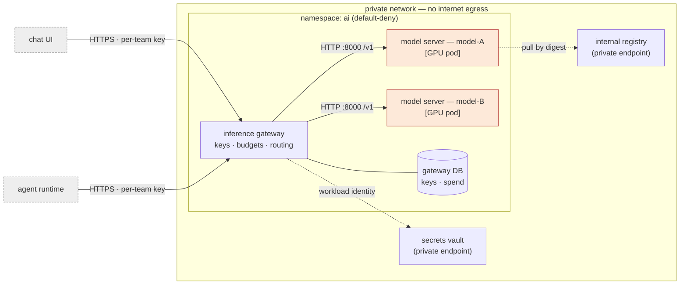
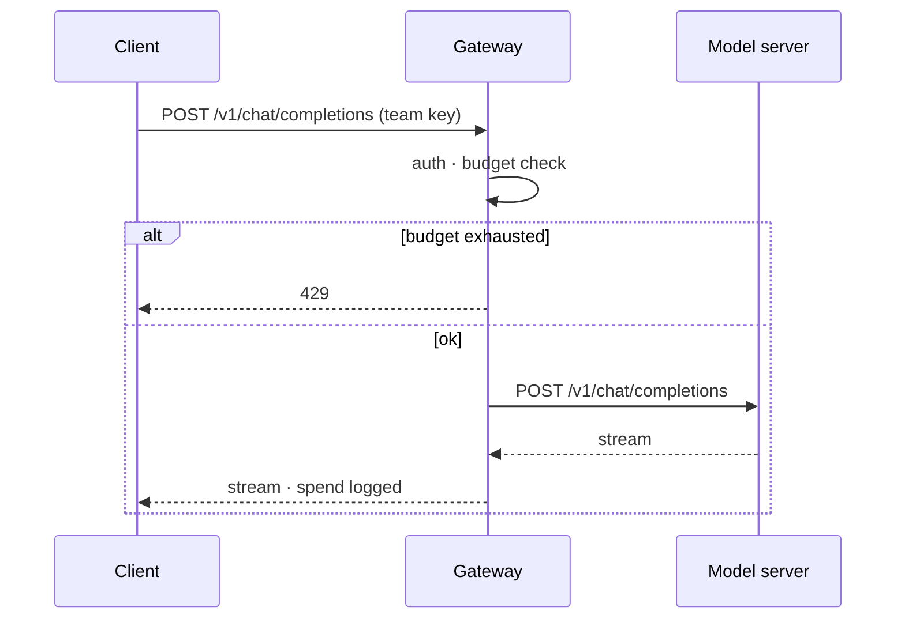

# Architecture diagrams — in the house format, next to the decision

## When to use this

A decision, design doc, ADR, or MR needs a picture, and the repo already has
pictures. The goal is a diagram a reader cannot tell apart from the existing ones
in tooling, level, naming, and style — and that is **text, in git**, rendered
offline.

**Not this skill if:** the question is *what* the architecture should be →
`write-design-doc`. The words of the decision → `adr`.

## §1 — Discover the house format (do this before drawing anything)

```bash
# what tooling exists?
find . \( -name '*.mmd' -o -name '*.mermaid' -o -name '*.puml' -o -name '*.plantuml' \
  -o -name '*.drawio' -o -name '*.dsl' -o -name '*.excalidraw' \) -not -path '*/node_modules/*' | head -30
grep -rl --include='*.md' -E '^```(mermaid|plantuml|puml)' docs/ README.md 2>/dev/null | head
grep -rniE 'mermaid|plantuml|structurizr|c4' mkdocs.yml .gitlab-ci.yml docs/README.md 2>/dev/null
ls docs/adr docs/design docs/diagrams docs/architecture 2>/dev/null
```

Read **two or three existing diagrams** of the kind you need and fill this table —
it is the spec you draw against:

| Convention | What the repo does (fill in) |
|---|---|
| Tool / fence | e.g. Mermaid in a ` ```mermaid ` fence inside the ADR · PlantUML `.puml` beside it · `.drawio` + exported `.svg` |
| Diagram type per level | context (C4 L1) · container (L2) · deployment · sequence · flow |
| Direction | `flowchart LR` vs `TB`; left-to-right for request flow, top-down for layers |
| Node naming | full names ("inference gateway") vs IDs; include tech in brackets? ("model server [GPU pod]") |
| Edge labels | protocol/port on every arrow? only on cross-boundary arrows? |
| Boundaries | `subgraph` per namespace / network / trust zone; dashed for external |
| Styling | a `classDef` block, PlantUML `skinparam`, or C4 `!include` — copy it verbatim |
| Legend | present? where? |
| File location + embedding | inline in the doc · `docs/diagrams/<name>.mmd` referenced by relative link · rendered `.svg` committed? |
| Vocabulary | names must match `docs/adr/`, the glossary, chart/release names |

If there is **no** existing diagram, default to **Mermaid inline in the ADR/design
doc** (steering §8) and record that choice in the ADR you are drawing for.

## §2 — Pick the level (one question per diagram)

| Reader's question | Draw | Keep to |
|---|---|---|
| What talks to what, and from where? | **Context / container** (C4 L1–L2) | ≤ 12 boxes; people + systems + the containers you own |
| Where does it run? | **Deployment** — cluster · namespaces · node pools · managed services behind private endpoints | one cluster/env per diagram |
| What happens on a request? | **Sequence** — client → gateway → model server, with auth and failure branch | ≤ 8 participants; one scenario |
| How does a change ship? | **Flow** — MR → validation → testing namespace → promotion | stages as nodes, gates as diamonds |
| Inside one component? | component (C4 L3) — rarely worth it here | only if a reviewer asked |

Trust and network boundaries are first-class on this platform: draw the no-egress
boundary, the network, the namespace with default-deny, and label the few arrows that
cross them. A diagram that hides the boundary hides the hardest part.

## §3 — Draft in the house tool

**Mermaid** (default) — reuse the repo's `classDef` block; if none, this one:



**PlantUML / C4-PlantUML** — the `!include` must point at a **vendored** copy
(`docs/diagrams/lib/C4_Container.puml`), never a URL: there is no internet where
this renders. Skeleton:

```plantuml
@startuml
!include lib/C4_Container.puml
LAYOUT_LEFT_RIGHT()
Person(user, "Platform user")
System_Boundary(cluster, "Kubernetes — ai namespace") {
  Container(gw, "Inference gateway", "service", "auth, budgets, routing")
  Container(ms, "Model server — model-A", "GPU pod", "OpenAI-compatible serving")
  ContainerDb(db, "Gateway DB", "keys, spend")
}
Rel(user, gw, "chat", "HTTPS")
Rel(gw, ms, "completions", "HTTP/8000")
Rel(gw, db, "reads/writes")
@enduml
```

**Sequence** (Mermaid) — one scenario, failure branch included:



**draw.io / Excalidraw** repos: edit the source file with the existing page's
style, export SVG with the same command the repo uses (check `Makefile` /
pipeline), commit **both** source and export.

## §4 — Match, then render, then place

```bash
# Mermaid (if mermaid-cli is in the tools image)
mmdc -i docs/diagrams/<name>.mmd -o docs/diagrams/<name>.svg
# PlantUML (java jar vendored in the repo or tools image)
java -jar tools/plantuml.jar -tsvg docs/diagrams/<name>.puml
# No renderer available? Say so; the human renders in their editor; still commit the source.
```

- Names in the diagram == names in the ADR, the Helm release, the Deployment.
  One vocabulary, so grep finds the thing the picture shows.
- Put the diagram **in or beside** the document it explains; link both ways.
- An MR that changes a flow the diagram shows **updates the diagram in the same
  MR** — the `deploy-reviewer` checklist and `review-pr` ask.
- Tools (mermaid-cli, plantuml) are dependencies: propose, don't install
  (guardrail 3); in the estate they come from the internal mirror.

## Failure modes

| Symptom | Cause | Fix |
|---|---|---|
| Diagram looks "foreign" next to the others | Skipped §1; different tool/direction/naming | Fill the convention table first; redraw |
| 30 boxes, nobody reads it | Several questions in one picture | One question per diagram (§2); split |
| Boundaries missing | Drew components, not trust zones | `subgraph` per network/namespace; label crossing arrows |
| PlantUML fails to render in CI | `!include` of a URL | Vendor the C4 lib; include by relative path |
| Mermaid parse error | `<br>` vs `<br/>`, unquoted labels with `()`/`:` | Quote labels `["…"]`; test with the renderer |
| Picture committed, source lost | Exported image only | Commit `.mmd`/`.puml`/`.drawio` source; image is derived |
| Diagram contradicts the ADR | Updated one, not the other | Same MR for both; link both ways |

## Definition of done

- [ ] Convention table filled from existing diagrams (or default recorded in the ADR)
- [ ] One question per diagram; level chosen; boundaries drawn and crossing arrows labelled
- [ ] Same tool, direction, naming, and style block as the repo's existing diagrams
- [ ] Source committed beside the ADR/design doc; rendered offline (or renderer gap stated)
- [ ] Names match ADRs / releases; both documents link to each other
